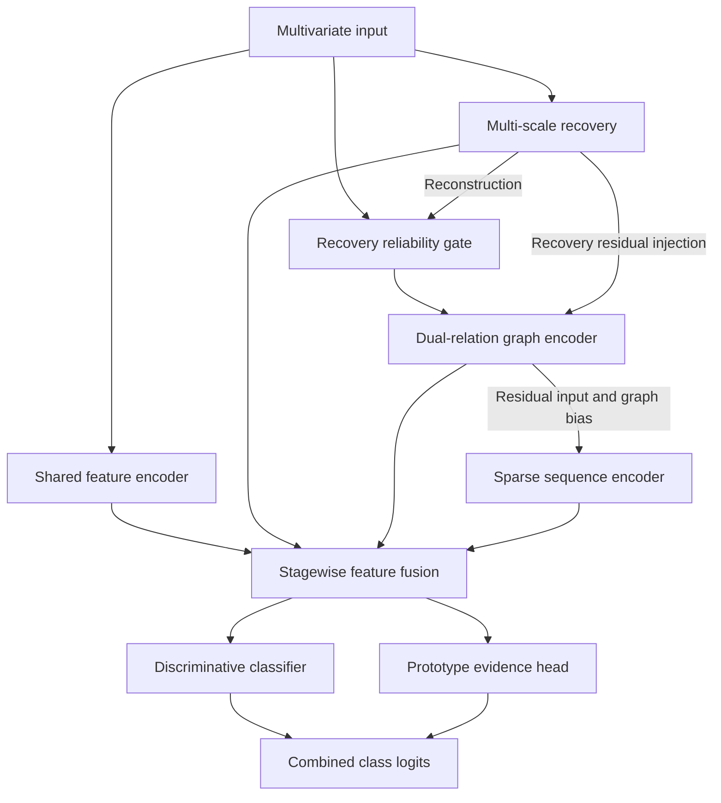

# RGIFormer

### Recovery, graph relations, and sparse sequence encoding for industrial fault diagnosis

RGIFormer is a neural network for classifying industrial process faults from multivariate measurements. It combines **multi-scale feature recovery**, **dual-relation graph learning**, and **graph-guided sparse sequence encoding** in a sequential architecture. A recovery-based gate adjusts the input, and a prototype head complements the final discriminative classifier.

The repository provides implementations for **BSM2 wastewater-treatment simulation data** and **papermaking process data**, together with neural baselines, traditional classifiers, and matched ablation training.

## Model overview

Industrial measurements contain both variable-specific information and relationships between variables. RGIFormer processes these signals in stages: it learns to reconstruct the input, uses the reconstruction to make a bounded input correction, learns variable relations, and encodes interactions between groups of features. Shared and stage-specific representations are then combined for classification.



The sequence encoder operates on **ordered feature-group tokens**. These tokens are not inherently chronological observations. The BSM2 implementation additionally provides optional lag and rolling features through a separate preprocessing module.

## Main components

| Component | How it works | Role in the model |
|---|---|---|
| **Multi-scale recovery** | Encodes grouped local features and the complete input, combines their representations with a learned gate, and reconstructs input features and group statistics. Training uses masked views and a consistency objective. | Learns representations from both local structure and global context. |
| **Recovery reliability gate** | Computes a score for each variable from its observed value, reconstructed value, and absolute reconstruction error. | Controls the magnitude of reconstruction-based input correction. These scores are learned gates, not calibrated sensor-health probabilities. |
| **Dual-relation graph encoder** | Combines a learned global adjacency with a sample-dependent adjacency using an edge-wise gate, applies sparsification and graph convolution, and derives a group-level graph bias. | Represents shared and sample-specific associations between process variables. |
| **Graph-guided sparse sequence encoder** | Converts feature groups into tokens, incorporates the graph bias into attention, and compresses the token sequence between encoder stages. | Models interactions across feature groups using the learned relational structure. |
| **Sequential stage fusion** | Injects small recovery and relation residuals into subsequent inputs, then progressively combines shared, recovery, relation, and sequence features. | Connects the stages through both input refinement and representation fusion. |
| **Prototype evidence head** | Projects the fused representation into a normalized embedding space and computes distances to learned class prototypes. | Adds a class-similarity score to the discriminative classifier's logits. |

### Recovery-guided input correction

For an input vector $x$, reconstruction $\hat{x}$, and learned gate $r$, the corrected input is

$$
\tilde{x} = x + \alpha(1-r)\odot(\hat{x}-x).
$$

The default correction scale is $\alpha=0.15$. The subsequent graph and sequence inputs also receive learned residual injections from the preceding stages.

### Classification and prototype scores

The final logits combine the discriminative classifier and the prototype head:

$$
z = z_{\mathrm{classifier}} + \beta z_{\mathrm{prototype}},
\qquad
z_{\mathrm{prototype},c} = -\frac{\lVert e-p_c\rVert_2^2}{\tau}.
$$

Here, $e$ and $p_c$ are normalized sample and class-prototype embeddings, $\tau$ is a learned positive scale, and the default prototype contribution is $\beta=0.35$. The predicted class is the index of the largest combined logit.

## Training objective

The main model is trained jointly with

$$
\mathcal{L} = \mathcal{L}_{\mathrm{classification}}
+ \lambda_{\mathrm{recovery}}\mathcal{L}_{\mathrm{recovery}}
+ \lambda_{\mathrm{graph}}\mathcal{L}_{\mathrm{graph}}
+ \mathcal{L}_{\mathrm{prototype}}.
$$

- **Classification:** focal loss, with configuration-dependent class weighting and label smoothing.
- **Recovery:** weighted feature reconstruction, group-statistic reconstruction, local/global alignment, and consistency between masked views.
- **Graph:** regularization of the learned global relation parameters.
- **Prototype:** prototype-based cross-entropy, attraction toward the target-class prototype, and a prototype-separation penalty.

The training scripts define the precise coefficients, data splits, early-stopping settings, and evaluation outputs. Ablation configurations selectively remove or modify model components to support controlled comparisons.

## Using the model

The model accepts a tensor of shape **`[batch_size, input_dim]`** and returns class logits of shape **`[batch_size, num_classes]`**.

```python
import torch
from trainCode.models.BSM2.BSM2_Baseline_Comparisons import build_model

model = build_model(
    input_dim=53,
    num_classes=13,
    device=torch.device("cpu"),
    model_name="rgiformer",
)
model.eval()

# Interface example with synthetic inputs and randomly initialized weights.
x = torch.randn(2, 53)
with torch.no_grad():
    logits = model(x)                  # [2, 13]
    details = model(x, return_aux=True)

# details also exposes reconstruction, reliability gates, prototype distances,
# and other intermediate quantities for analysis.
```

Train a model or load compatible trained weights before using its predictions.

## Code layout

| Entry point | Purpose |
|---|---|
| [BSM2 model and baselines](trainCode/models/BSM2/BSM2_Baseline_Comparisons.py) | BSM2 RGIFormer, neural baselines, training and evaluation |
| [BSM2 temporal preprocessing](trainCode/models/BSM2/bsm2_temporal_features.py) | Optional lag and rolling features |
| [Papermaking RGIFormer](trainCode/models/Paper/RAE_GCN_Informer_Paper_ModularInnov.py) | Main papermaking model and training pipeline |
| [Papermaking neural baselines](trainCode/models/Paper/Paper_Baseline_Comparisons.py) | Neural model comparisons |
| [Matched ablations](trainCode/training/run_current_rgiformer_ablations.py) | Papermaking component ablations |
| [Traditional baselines](trainCode/training/run_traditional_baselines.py) | Traditional classification models |

## Installation and training

Use Python 3.10 or newer in a dedicated environment. Install the dependencies and select a PyTorch build appropriate for your CPU or CUDA installation:

```bash
python -m pip install -r requirements.txt
```

Supply compatible CSV inputs. The default directory layout is:

```text
parent/
  RGIFormer/
  data/
    BSM2/bsm2_train_data.csv
    BSM2/bsm2_test_data.csv
    Paper/prediction_dataset_full_11000.csv
```

BSM2 uses numeric process variables and an integer `label` column; optional temporal preprocessing uses `time_day`. The main papermaking loader requires `fault_id` and `fault_name`, removes these two columns, and uses all remaining columns as numeric features in CSV order. Consult the loaders and CLI options for the full input contract and custom paths.

Run training commands from the repository root:

```bash
# BSM2 RGIFormer with static features.
python -m trainCode.models.BSM2.BSM2_Baseline_Comparisons --model rgiformer --mode single --seed 42 --temporal-features none --tuning-profile legacy --device auto

# Papermaking RGIFormer.
python -m trainCode.models.Paper.RAE_GCN_Informer_Paper_ModularInnov --mode single --seed 42 --device auto

# Inspect matched-ablation options.
python -m trainCode.training.run_current_rgiformer_ablations --help
```

All five training entry points support `--help`. Training produces weights and results locally; these generated artifacts are excluded by the repository's publication allowlist.

## Scope

This repository distributes model and training source code. Datasets, pretrained weights, saved experiment results, and manuscript materials are not included. Reproducing an experiment requires compatible inputs, its split protocol and configuration, and suitable compute.

The learned graph describes model associations and does not by itself establish causal process connections. Papermaking sample-level classification does not establish temporal forecasting or prospective plant validation; BSM2 within-label lag construction also requires careful interpretation of chronology.
