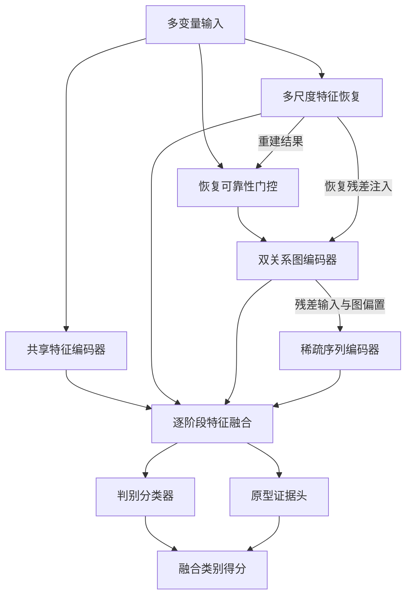
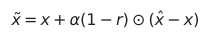
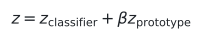
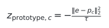
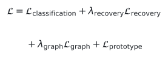

# RGIFormer

[English](README.md) | **简体中文**

### 融合特征恢复、图关系建模与稀疏序列编码的工业故障诊断模型

RGIFormer 是面向多变量工业过程测量数据的故障分类神经网络。模型以串行结构融合**多尺度特征恢复**、**双关系图学习**和**图引导的稀疏序列编码**，利用恢复可靠性门控修正输入，并结合判别分类器与类别原型完成故障判别。

本仓库提供针对 **BSM2 污水处理仿真数据**和**造纸过程数据**的实现，同时包含神经网络基线、传统分类器及匹配消融实验的训练代码。

## 模型概览

工业测量数据既包含单个变量的状态信息，也包含变量之间的关联。RGIFormer 分阶段处理这些信息：首先学习重建输入，依据重建结果对原始输入做小幅修正，随后学习变量关系，再对特征组之间的交互进行编码，最终融合共享表征和各阶段表征进行分类。



序列编码器处理的是**按顺序组织的特征组 token**，这些 token 本身并不代表时间序列观测。BSM2 实现另提供独立的预处理模块，可选用滞后特征和滚动统计特征。

## 核心模块

| 模块 | 实现方式 | 在模型中的作用 |
|---|---|---|
| **多尺度特征恢复** | 分别编码局部特征组和完整输入，以可学习门控融合两种表征，并重建输入特征和组内统计量；训练时引入掩码视图及一致性目标。 | 同时学习局部结构和全局上下文。 |
| **恢复可靠性门控** | 根据各变量的观测值、重建值和绝对重建误差计算门控分数。 | 控制基于重建结果的输入校正幅度；该分数是学习得到的门控量，并非经过校准的传感器健康概率。 |
| **双关系图编码器** | 通过边级门控融合可学习的全局邻接关系与随样本变化的邻接关系，进行稀疏化和图卷积，并生成特征组层面的图偏置。 | 表示过程变量间的共享关联和样本特定关联。 |
| **图引导的稀疏序列编码器** | 将特征组转换为 token，在注意力中引入图偏置，并在编码层之间压缩 token 序列。 | 利用已学习的关系结构建模跨特征组交互。 |
| **串行阶段融合** | 将较小的恢复残差和关系残差注入后续输入，逐步融合共享、恢复、关系及序列表征。 | 通过输入修正与表征融合连接各阶段。 |
| **原型证据头** | 将融合表征映射到归一化嵌入空间，计算其与可学习类别原型之间的距离。 | 将类别相似性得分加入判别分类器的 logits。 |

### 恢复引导的输入校正

设输入向量为 x，重建结果为 x̂，学习得到的门控为 r，校正后的输入为：



<details>
<summary>LaTeX 源码</summary>

```latex
\tilde{x} = x + \alpha(1-r)\odot(\hat{x}-x).
```

</details>

默认校正系数为 α = 0.15。后续图编码器与序列编码器的输入还会接收来自前一阶段的可学习残差注入。

### 分类与原型得分

最终类别 logits 由判别分类器得分与原型得分加权相加得到：



<details>
<summary>LaTeX 源码</summary>

```latex
z = z_{\mathrm{classifier}} + \beta z_{\mathrm{prototype}}.
```

</details>



<details>
<summary>LaTeX 源码</summary>

```latex
z_{\mathrm{prototype},c} = -\frac{\lVert e-p_c\rVert_2^2}{\tau}.
```

</details>

其中，e 和 p<sub>c</sub> 分别为归一化后的样本嵌入与类别原型，τ 为可学习的正值尺度参数。默认原型贡献系数为 β = 0.35，预测类别为融合得分最大的类别。

## 训练目标

主模型采用以下联合训练目标：



<details>
<summary>LaTeX 源码</summary>

```latex
\begin{aligned}
\mathcal{L} ={}& \mathcal{L}_{\mathrm{classification}}
+ \lambda_{\mathrm{recovery}}\mathcal{L}_{\mathrm{recovery}} \\
&+ \lambda_{\mathrm{graph}}\mathcal{L}_{\mathrm{graph}}
+ \mathcal{L}_{\mathrm{prototype}}.
\end{aligned}
```

</details>

- **分类损失：**采用焦点损失（focal loss），类别权重和标签平滑由具体配置决定。
- **恢复损失：**包括加权特征重建、组内统计量重建、局部与全局表征对齐，以及不同掩码视图之间的一致性约束。
- **图正则项：**约束可学习的全局关系参数。
- **原型损失：**包括基于原型的交叉熵、样本向目标类别原型的聚拢约束，以及原型间的分离惩罚。

各训练脚本定义了具体损失权重、数据划分、早停设置和评估输出。消融配置通过有控制地移除或修改模型组件，支持组件作用的对照分析。

## 模型使用示例

模型接收形状为 **`[batch_size, input_dim]`** 的张量，输出形状为 **`[batch_size, num_classes]`** 的类别 logits。

```python
import torch
from trainCode.models.BSM2.BSM2_Baseline_Comparisons import build_model

model = build_model(
    input_dim=53,
    num_classes=13,
    device=torch.device("cpu"),
    model_name="rgiformer",
)
model.eval()

# 仅演示接口：使用合成输入和随机初始化的模型权重。
x = torch.randn(2, 53)
with torch.no_grad():
    logits = model(x)                  # [2, 13]
    details = model(x, return_aux=True)

# details 还提供重建结果、可靠性门控、原型距离等中间量，便于分析。
```

使用预测结果前，需要训练模型或加载匹配的已训练权重。

## 代码结构

| 入口 | 用途 |
|---|---|
| [BSM2 模型与基线](trainCode/models/BSM2/BSM2_Baseline_Comparisons.py) | BSM2 RGIFormer、神经网络基线及训练评估 |
| [BSM2 时间特征预处理](trainCode/models/BSM2/bsm2_temporal_features.py) | 可选的滞后与滚动统计特征 |
| [造纸 RGIFormer](trainCode/models/Paper/RAE_GCN_Informer_Paper_ModularInnov.py) | 造纸主模型及训练流程 |
| [造纸神经网络基线](trainCode/models/Paper/Paper_Baseline_Comparisons.py) | 神经网络模型对比 |
| [匹配消融实验](trainCode/training/run_current_rgiformer_ablations.py) | 造纸模型组件消融 |
| [传统分类基线](trainCode/training/run_traditional_baselines.py) | 传统分类模型 |

## 环境安装与训练

建议使用 Python 3.10 或更高版本的独立环境，并根据 CPU 或 CUDA 环境选择合适的 PyTorch 版本：

```bash
python -m pip install -r requirements.txt
```

需要自行准备符合输入格式的 CSV 文件，默认目录结构为：

```text
parent/
  RGIFormer/
  data/
    BSM2/bsm2_train_data.csv
    BSM2/bsm2_test_data.csv
    Paper/prediction_dataset_full_11000.csv
```

BSM2 输入包含数值型过程变量和整数类别列 `label`；可选的时间特征预处理使用 `time_day`。造纸主模型的数据加载器要求包含 `fault_id` 和 `fault_name`，删除这两列后，将其余列按 CSV 中的顺序作为数值特征。完整输入要求和自定义路径参数见相应加载器及命令行帮助。

在仓库根目录运行：

```bash
# 使用静态特征的 BSM2 RGIFormer。
python -m trainCode.models.BSM2.BSM2_Baseline_Comparisons --model rgiformer --mode single --seed 42 --temporal-features none --tuning-profile legacy --device auto

# 造纸 RGIFormer。
python -m trainCode.models.Paper.RAE_GCN_Informer_Paper_ModularInnov --mode single --seed 42 --device auto

# 查看匹配消融实验选项。
python -m trainCode.training.run_current_rgiformer_ablations --help
```

五个训练入口均支持 `--help`。训练生成的权重和结果保存于本地，仓库上传白名单会排除这些生成文件。

## 使用范围

本仓库发布模型与训练源码，不包含数据集、预训练权重、已保存的实验结果或文稿材料。复现实验需要匹配的输入数据、数据划分方案、运行配置和计算资源。

学习得到的图表示模型中的关联，不能单独证明真实过程的因果关系。造纸数据上的样本级分类结果不能直接作为时间预测或前瞻性工厂验证的依据；使用 BSM2 类别内部构建的滞后特征时，也需要明确其时间顺序的含义。
